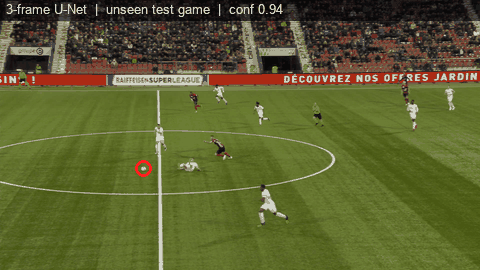
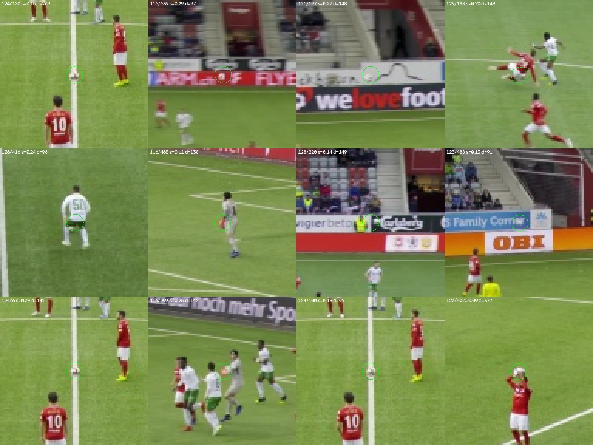
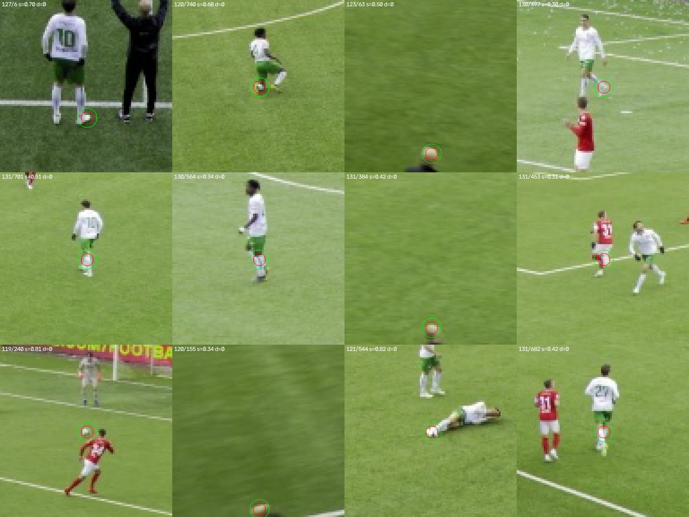

# Ball detection in broadcast football video

A 3-frame heatmap U-Net, trained from scratch on SoccerNet-Tracking, that finds the ball in broadcast football footage.



*The model on a game it never saw during training (clip SNMOT-146). The red circle is the predicted ball and the yellow line is the recent trajectory. When the confidence falls below the threshold, no circle is drawn.*

## TL;DR

- On 2 unseen games, a **3-frame U-Net trained from scratch at 640×352** matches a **COCO-pretrained YOLO11s at 1280 px**: test F1 **0.717** vs **0.714**.
- **The model uses motion.** If the same frame is given three times, F1 drops from 0.759 to 0.716 (validation), with no other change.
- **The remaining errors are a few hard cases:** a ball on top of a player, a very small ball, or a fast ball. In 82% of the frames the ball is among the 3 strongest peaks of the heatmap, which leaves a lot of room for temporal tracking.

## Problem and data

In a broadcast frame the ball is tiny (median ~20 px at 1920×1080, under 7 px after resizing). It is motion-blurred when it travels fast and often hidden by players. A single frame is often not enough even for a human; the motion over a few frames gives it away.

**Dataset:** [SoccerNet-Tracking 2023](https://www.soccer-net.org/), 106 clips of 30 s (750 frames at 25 fps), with a box for every ball in every frame.

**Split by game, not by frame.** Consecutive frames are almost identical, so a random frame split would leak test data into training.

| Split | Games | Clips | Samples |
|---|---|---|---|
| train | 4, 6, 9 | 57 | 42,636 |
| val | 7 | 16 | 11,968 |
| test | 8, 11 | 33 | 24,684 |

16 clips have two annotated balls in the same frame. The heatmap target contains all of them, and evaluation uses the first annotated ball.

## Approach

```
frames t-1, t, t+1  ──►  stack to 9 channels  ──►  U-Net  ──►  heatmap (1×352×640)  ──►  peak = ball, peak value = confidence
   (3×3×352×640)           (9×352×640)
```

- **Input:** 3 consecutive RGB frames resized to 640×352 and stacked on the channel axis, so motion is visible to the first convolution.
- **Target:** a Gaussian heatmap (σ = 2 px) centred on each ball. The model learns *where* the ball is, not a box around it.
- **Model:** U-Net with 4 levels (32 → 256 channels), 7.8M parameters, trained from scratch.
- **Loss:** CenterNet-style focal loss. Almost every pixel is background, and a plain BCE learns to predict "no ball" everywhere.
- **Training:** AdamW with lr 1e-3, cosine schedule, mixed precision, batch 8, 6 epochs on a single 8 GB GPU. Augmentation: horizontal flip, plus brightness and contrast applied identically to the 3 frames.
- **Prediction:** the highest peak of the heatmap. Its value is the confidence, and frames below the threshold are reported as "no ball".

**Baseline:** YOLO11s (Ultralytics), COCO-pretrained, fine-tuned for 10 epochs on the same training games at 1280 px. The standard off-the-shelf recipe for small objects. Per frame, the most confident box is the prediction.

## Results

**Metric:**
- A prediction is **correct** if it lies within **4 px** (640×352, about 12 px at 1080p) of the annotated ball.
- A **false positive** is a confident prediction that is wrong.
- A **false negative** is a frame with a ball and no correct prediction.
- The confidence threshold is chosen on the validation game and applied **once** to test.

| Model | Input | Init | Val F1 | Test P | Test R | **Test F1** |
|---|---|---|---|---|---|---|
| **U-Net (ours)** | 3 frames, 640×352 | from scratch | 0.759 | 0.820 | 0.637 | **0.717** |
| U-Net, no motion (frame t repeated ×3) | 1 frame | same weights | 0.716 | – | – | – |
| YOLO11s | 1 frame, 1280 | COCO | 0.784 | 0.830 | 0.626 | 0.714 |

On correct detections the mean localisation error is 0.96 px for the U-Net and 0.86 px for YOLO (640×352).

- **The two models are on par on test,** even though the U-Net has no pretraining and sees the frame at half the resolution. The gap to close is resolution and pretraining, not the approach.
- **YOLO generalises worse** from validation to test (0.784 → 0.714, against 0.759 → 0.717 for the U-Net).
- **Both models have high precision and the same recall ceiling (~0.63).** They fail on the same hard cases, which a single-frame detector cannot solve on its own.

## Error analysis (validation game)

Recall by condition:

| Condition | Recall |
|---|---|
| All frames with a ball | 0.70 |
| Ball in the open / ball overlapping a player | 0.78 / **0.52** |
| Ball smaller than 3.5 px | **0.51** |
| Fast ball (> 6 px/frame) / slow ball | **0.48** / 0.77 |
| Ball standing still (e.g. before a kick-off) | 0.66 |

- **Ball overlapping a player** is the largest error source: about 30% of the frames, with recall dropping by a third. The ball hides against the shirt or between the legs.
- **Fast balls** are blurred into a streak. Here the model often finds the ball but a few pixels off: 41% of the "wrong place" errors are within 8 px.
- **A ball standing still is harder than a slow one.** With no motion the model loses its strongest cue: a still ball looks like any white spot.
- **Errors come in streaks.** 43% of error frames belong to streaks of 5 frames or fewer, which a tracker can bridge; 21% belong to streaks longer than 1 second.
- **The ball is often there but not first.** It is among the top-3 heatmap peaks in 82% of the frames, against 76% for the top peak alone.
- **Some false positives are not errors.** In a random sample of "false alarms" (frames with no annotated ball), most crops show a real ball that is simply missing from the annotations. The measured precision is therefore a lower bound.

**Missed balls** (the green circle is the annotated ball): a still ball at kick-off, a ball in the goalkeeper's hands, a ball in front of advertising boards, and a ball between players' legs.



**"False alarms"** (frames with no annotated ball, crop centred on the prediction): most of them contain a real ball.



## Reproduce

Requirements: Python 3.11, a CUDA GPU (8 GB is enough), `pip install -r requirements.txt`.

1. **Get the data.** SoccerNet-Tracking 2023, via the `SoccerNet` pip package; see the [SoccerNet docs](https://www.soccer-net.org/data). Extract it to `data/raw/SoccerNet/tracking-2023/{train,test}/SNMOT-*`.
2. **Build the dataset:** labels, game-based split and resized frames, written to `data/processed/`.
   ```
   python scripts/prepare_dataset.py
   ```
3. **Train the U-Net** (TensorBoard logs and checkpoints go to `runs/unet_focal_b_aug/`):
   ```
   python -m src.train
   ```
4. **Evaluate.** The first command chooses the threshold on validation; the second reports test once.
   ```
   python -m src.evaluate
   python -m src.evaluate --test
   ```
5. **Run the error analysis** (validation):
   ```
   python -m scripts.error_analysis
   ```
6. **YOLO baseline:**
   ```
   python -m scripts.prepare_yolo
   python -m scripts.train_yolo
   python -m scripts.eval_yolo
   python -m scripts.eval_yolo --test
   ```

```
src/        dataset.py (heatmap targets, 3-frame samples), model.py (U-Net), train.py, evaluate.py
scripts/    data preparation, error analysis, YOLO baseline
assets/     images used in this README
```
